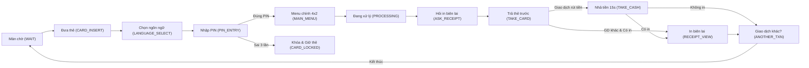

# 🏧 VITB - VITBANK ViTM SIMULATOR (v2.0.0)

Hệ thống mô phỏng ki-ốt giao dịch ngân hàng tự động **ViTM** của ngân hàng **VITB - VITBANK**, xây dựng theo kiến trúc phân tầng chuẩn **Maven (Java 21 + Java Swing + JDBC MySQL 8.4)**, tích hợp bộ kiểm thử tự động **JUnit 5 + H2 In-Memory Database**.

---

## 🎨 1. Hệ Thống Thiết Kế & Khung Phần Cứng Ki-ốt (Cam ViT Design System)

Giao diện mô phỏng trọn vẹn khung máy ki-ốt vật lý tỷ lệ 4:3 (`1024×768`) với màn hình LCD trung tâm, **8 phím cứng FDK** hai bên và **3 khe phần cứng** có đèn LED báo hiệu trạng thái theo ngữ cảnh:

| Thành phần | Mã màu | Vai trò hiển thị |
|---|---|---|
| **Cam ViT (Primary)** | `#E0562D` | Thương hiệu `VITB - VITBANK`, huy hiệu `ViTM`, nút hành động chính, viền tiêu điểm (focus) |
| **Cam đậm (Primary Dark)** | `#C2411E` | Hiệu ứng nhấn nút, trạng thái active |
| **Nền màn hình (Screen BG)** | `#FAF8F5` | Nền kem ấm tách lớp rõ với các khung thẻ nội dung trắng `#FFFFFF` |
| **Nền thẻ nhấn (Accent BG)** | `#FFF7ED` | Khung thông tin tài khoản, thẻ nổi bật (viền `#FED7AA`) |
| **Chữ chính (Dark Charcoal)** | `#18181B` | Văn bản, số tiền, thông tin đối soát độ tương phản cao |
| **Vỏ máy Bezel & Phím FDK** | `#1E2024` / `#3F424A` | Khung vỏ ki-ốt, cụm 8 phím FDK (`F1`–`F8`) và 3 khe phần cứng (`KHE THẺ`, `KHE NHẬN TIỀN`, `KHE BIÊN LAI`) |
| **Trạng thái ngữ nghĩa** | `#10B981` / `#D97706` / `#DC2626` | Thành công (Xanh lục) • Cảnh báo/Xóa (Vàng hổ phách) • Lỗi/Hủy/Khóa (Đỏ) |

---

## 🏗️ 2. Kiến Trúc Phân Tầng & Cấu Trúc Thư Mục

Mã nguồn được tổ chức theo kiến trúc phân tầng rõ ràng (**UI → Service → DAO → Database**), tối ưu hóa tái sử dụng qua lớp cha trừu tượng (`BaseDao`, `BaseService`, `CashVault extends CashBreakdown`) và hoàn toàn không chứa chú thích thừa.

```text
ViTM/
├── pom.xml                                 # Cấu hình Maven (Java 21, MySQL Connector/J 8.4, JUnit 5, H2)
├── README.md                               # Tài liệu hướng dẫn toàn diện dự án
├── database/
│   ├── schema.sql                          # DDL khởi tạo CSDL atm_db (6 bảng chuẩn khóa ngoại & chỉ mục)
│   ├── seed.sql                            # Dữ liệu mẫu: quỹ tiền, cấu hình ViTM, tài khoản nội bộ & liên ngân hàng
│   └── migrations/
│       └── V2__add_audit_log.sql           # Kịch bản nâng cấp bảng nhật ký kiểm toán & quỹ tiền
├── scripts/
│   ├── init_db.bat                         # Script nạp tự động schema.sql và seed.sql vào MySQL
│   ├── run.bat                             # Script biên dịch & khởi chạy ứng dụng trên Windows
│   └── run.sh                              # Script biên dịch & khởi chạy ứng dụng trên Linux/macOS
├── docs/
│   ├── architecture.md                     # Tài liệu kiến trúc phân tầng hệ thống
│   ├── flow-diagram.md                     # Sơ đồ Mermaid luồng trạng thái ATMState
│   ├── BaoCao_ThietKe_KiemThu_ATM.html     # Báo cáo thiết kế & kiểm thử chi tiết (HTML)
│   ├── BaoCao_ThietKe_KiemThu_ATM.pdf      # Báo cáo thiết kế & kiểm thử chi tiết (PDF)
│   └── screenshots/                        # Bộ 31 ảnh chụp toàn bộ màn hình & popup trạng thái
└── src/
    ├── main/
    │   ├── java/com/vietbank/atm/
    │   │   ├── Main.java                   # Điểm khởi chạy ứng dụng
    │   │   ├── config/                     # AppConfig (đọc cấu hình), DbConfig (quản lý kết nối & tự khởi tạo DB)
    │   │   ├── state/                      # ATMState (26 trạng thái), SessionManager (phiên & bộ đếm timeout)
    │   │   ├── model/                      # Account, Card, BankInfo, CashBreakdown, CashVault, TransactionRecord/Result
    │   │   ├── dao/                        # BaseDao, AccountDao, CardDao, CashDao, TransactionDao, AuditLogDao
    │   │   ├── service/                    # BaseService, AuthService, WithdrawService, DepositService,
    │   │   │                               # TransferService, PinService, CashDispenser, ATMSystemService
    │   │   ├── ui/                         # MainFrame, component/ (ATMDialogs, HardwareSlotPanel),
    │   │   │                               # theme/ (Colors, Fonts, Theme)
    │   │   └── util/                       # Hasher (PBKDF2 + SHA-256), I18n (ResourceBundle UTF-8), MoneyFormat
    │   └── resources/
    │       ├── application.properties      # Thông số vận hành máy ViTM (VITB-DN-086, hạn mức, timeout)
    │       └── i18n/
    │           ├── messages_vi.properties  # Từ điển giao diện Tiếng Việt
    │           └── messages_en.properties  # Từ điển giao diện Tiếng Anh
    └── test/
        └── java/com/vietbank/atm/
            ├── service/                    # CashDispenserTest, PinServiceTest, TransferServiceTest, TransactionServicesTest
            └── util/                       # FormatAndI18nTest
```

---

## 🔄 3. Luồng Nghiệp Vụ & Tính Năng Nổi Bật

### 3.1. Luồng trạng thái chuẩn máy giao dịch thực tế (`ATMState`)


### 3.2. Điểm nhấn kỹ thuật & bảo mật
- **Bảo vệ an toàn trước quên thẻ (Card-Before-Cash)**: Sau khi giao dịch được duyệt và chọn in/không in biên lai, máy bắt buộc đẩy thẻ ra tại **KHE THẺ** và chờ khách nhận lại thẻ trước khi mở **KHE NHẬN TIỀN**.
- **Đếm ngược thu hồi tiền mặt 15 giây**: Tại màn hình nhận tiền (`TAKE_CASH`), bộ đếm thời gian thực đếm ngược từ `15s` về `0s`; nếu khách không nhận, máy tự động thu hồi tiền vào khay bảo mật và cảnh báo.
- **Thuật toán chia tiền mặt thông minh (`CashDispenser`)**: Kết hợp quy hoạch động (Dynamic Programming) và tham lam (Greedy) trên 4 mệnh giá `500.000đ`, `200.000đ`, `100.000đ`, `50.000đ`, đảm bảo số tờ tối thiểu và không vượt quá giới hạn **40 tờ/lần rút**.
- **Giao dịch CSDL chuẩn ACID & Chống Deadlock**:
  - Sử dụng `SELECT ... FOR UPDATE` để khóa dòng tài khoản và kho tiền trong suốt giao dịch.
  - Khi chuyển khoản nội bộ (`VITB - VITBANK`), hệ thống luôn khóa hai tài khoản theo thứ tự `id` tăng dần (`Math.min(accId, destId)` trước), triệt tiêu hoàn toàn nguy cơ deadlock khi hai tài khoản chuyển chéo `A ↔ B` đồng thời.
- **Băm mã PIN có muối (`PBKDF2WithHmacSHA256`)**: Mã PIN mới được băm với Salt ngẫu nhiên 128-bit và `65.536` vòng lặp (`PBKDF2$65536$<salt>$<hash>`), đồng thời tương thích ngược với dữ liệu băm `SHA-256` kèm kiểm tra chặn PIN yếu (`000000`, `123456`, `654321`, số lặp).
- **Bảo mật hiển thị**: Tự động che số thẻ (`9704 •••• •••• 7890`), che số tài khoản (`••••••7890`) trên màn hình và biên lai; chuẩn hóa tên chủ thẻ không dấu in hoa theo chuẩn ngân hàng.

---

## 💳 4. Dữ Liệu Thử Nghiệm Có Sẵn (`database/seed.sql`)

### 4.1. Thẻ & Tài khoản nội bộ (`VITB - VITBANK` — Miễn phí chuyển khoản)
| STT | Số thẻ (16 số) | Số tài khoản | Chủ tài khoản | Mã PIN | Số dư ban đầu | Trạng thái |
|---|---|---|---|---|---|---|
| 1 | `9704 0012 3456 7890` | `1234567890` | NGUYỄN VĂN AN | `123456` | `50.000.000 VNĐ` | `ACTIVE` (Đủ số dư & lịch sử 10 GD) |
| 2 | `9704 0098 7654 3210` | `0987654321` | TRẦN THỊ BÍCH | `654321` | `1.000.000 VNĐ` | `ACTIVE` (Thử nghiệm nhận CK / vượt số dư) |
| 3 | `9704 0011 1122 2233` | `1111222233` | LÊ HOÀNG MINH | `111111` | `30.000.000 VNĐ` | `LOCKED` (Thử nghiệm thẻ bị khóa) |

### 4.2. Tài khoản liên ngân hàng (Phí chuyển khoản `5.500 VNĐ/giao dịch`)
| Mã NH | Ngân hàng thụ hưởng | Số tài khoản nhận | Tên người thụ hưởng |
|---|---|---|---|
| `VCB` | Vietcombank | `0011001234567` | PHẠM MINH TUẤN |
| `TCB` | Techcombank | `1903456789012` | NGUYỄN THỊ LAN ANH |
| `MB` | MB Bank | `0905123456` | HOÀNG QUỐC BẢO |
| `BIDV` | BIDV | `31410001234567` | ĐẶNG VĂN HÙNG |
| `CTG` | VietinBank | `108001234567` | VŨ THỊ MAI HƯƠNG |

---

## ⌨️ 5. Phím Tắt Điều Khiển & Chế Độ Kỹ Thuật Viên

| Phím tắt | Chức năng |
|---|---|
| `F1` – `F4` | Tương ứng 4 phím cứng FDK cột bên trái màn hình |
| `F5` – `F8` | Tương ứng 4 phím cứng FDK cột bên phải màn hình |
| `Enter` / `Esc` | Xác nhận thao tác hiện tại / Hủy bỏ hoặc Quay lại |
| `Ctrl + Shift + D` | Mở **Bảng Điều Khiển Kỹ Thuật Viên (Dev / Admin Panel)**: cấu hình MySQL, nạp lại quỹ tiền, chuyển trạng thái `ONLINE` / `MAINTENANCE`, đưa nhanh thẻ mẫu vào khe đọc |
| `Ctrl + Shift + Q` | Thoát nhanh ki-ốt |

---

## 🚀 6. Hướng Dẫn Cài Đặt, Khởi Chạy & Kiểm Thử

### Yêu cầu môi trường
- **JDK**: Java 21 trở lên
- **Build Tool**: Apache Maven 3.9+
- **Cơ sở dữ liệu**: MySQL Server 8.0 / 8.4 (chạy tại `localhost:3306`, database `atm_db`)

### Bước 1: Khởi tạo Cơ sở dữ liệu MySQL
- **Cách 1 (Tự động qua Script trên Windows):**
  ```bat
  scripts\init_db.bat
  ```
- **Cách 2 (Trực tiếp trong ứng dụng):** Khởi chạy ứng dụng, nhấn `Ctrl + Shift + D` để mở bảng Kỹ thuật viên, chọn **Cấu hình MySQL & Khởi tạo lại DB mẫu**, nhập tài khoản `root` và mật khẩu để ứng dụng tự động nạp `schema.sql` và `seed.sql`.

### Bước 2: Biên dịch và khởi chạy ứng dụng
```bash
# Chạy bằng Maven
mvn clean compile exec:java

# Hoặc dùng script khởi chạy nhanh
scripts\run.bat      # Windows
./scripts/run.sh     # Linux / macOS
```

### Bước 3: Chạy bộ kiểm thử tự động (20 Unit & Concurrency Tests)
Bộ kiểm thử chạy hoàn toàn độc lập trên **H2 In-Memory Database (chế độ tương thích MySQL)** mà không làm ảnh hưởng dữ liệu MySQL thật:
```bash
mvn test
```
Kiểm chứng đầy đủ 5 nhóm nghiệp vụ:
1. `CashDispenserTest` (5 tests): Chia mệnh giá tối ưu, vét cạn mệnh giá nhỏ khi hết tờ lớn, giới hạn 40 tờ/giao dịch, kiểm tra hạn mức.
2. `PinServiceTest` (5 tests): Băm và xác thực `PBKDF2` có muối ngẫu nhiên, tương thích ngược `SHA-256`, phát hiện PIN yếu và kiểm tra bước đổi PIN.
3. `TransactionServicesTest` (5 tests): Khóa thẻ sau 3 lần sai PIN, rút/nạp cập nhật kho tiền, rollback khi tài khoản nhận không tồn tại, chống rút âm số dư khi đa luồng và chống deadlock khi chuyển khoản chéo `A ↔ B`.
4. `TransferServiceTest` (3 tests): Kiểm tra phí liên ngân hàng, chặn chuyển khoản cho chính mình và kiểm tra hạn mức ngày.
5. `FormatAndI18nTest` (2 tests): Định dạng tiền tệ, che số thẻ/tài khoản, bỏ dấu tên tiếng Việt và chuyển đổi ngôn ngữ `VI / EN`.
